  <a href="https://fruntes-portfolio-magic.vercel.app/en/">
    <picture>
      <source media="(prefers-color-scheme: dark)" srcset="assets/profil-en-dark.svg">
      
    </picture>
  </a>
  

    <a href="https://fruntes-portfolio-magic.vercel.app/en/">Portfolio</a> ·
    <a href="https://fruntes-portfolio-magic.vercel.app/cv/Maxime_Fruntes_CV_EN.pdf">CV (PDF)</a> ·
    <a href="https://www.linkedin.com/in/maxime-fruntes-2538543a5/">LinkedIn</a> ·
    <a href="mailto:maxime.fruntes@gmail.com">Email</a> ·
    <a href="https://github.com/narusly">Version française</a>
  

### Projects

The repositories are documented in French; each README opens with a short summary of the results.

| Project | Key result | Methods |
| --- | --- | --- |
| [scoring-appetence](https://github.com/narusly/scoring-appetence) | Random validation overstates performance: AUC of 0.77, versus 0.65 out of time. | WoE/IV scorecard, XGBoost, drift monitoring (PSI) |
| [var-monte-carlo](https://github.com/narusly/var-monte-carlo) | Gaussian Monte Carlo is rejected by the Kupiec test; with a Student distribution it passes. | VaR and Expected Shortfall, backtesting on 15 years of ECB rates |
| [segmentation-clients](https://github.com/narusly/segmentation-clients) | 13% of customers account for 36% of payment defaults. | K-means on 30,000 cardholders, bootstrap stability |
| [spc-fonderie](https://github.com/narusly/spc-fonderie) | A 0.5σ shift is detected in 8 samples by EWMA, versus 31 for Shewhart. | Shewhart, EWMA and CUSUM at equal false-alarm rates |
| [automate-cellulaire](https://github.com/narusly/automate-cellulaire) | Percolation threshold estimated at 0.5926, against a theoretical value of 0.5927. | Stochastic automaton, Monte Carlo, finite-size analysis |

Card generated by <a href="build.py">build.py</a> from <a href="profil.toml">profil.toml</a>; the statistics are recomputed every week by GitHub Actions.
