  <a href="https://fruntes-portfolio-magic.vercel.app">
    <picture>
      <source media="(prefers-color-scheme: dark)" srcset="assets/profil-fr-dark.svg">
      
    </picture>
  </a>
  

    <a href="https://fruntes-portfolio-magic.vercel.app">Portfolio</a> ·
    <a href="https://fruntes-portfolio-magic.vercel.app/cv/Maxime_Fruntes_CV_FR.pdf">CV (PDF)</a> ·
    <a href="https://www.linkedin.com/in/maxime-fruntes-2538543a5/">LinkedIn</a> ·
    <a href="mailto:maxime.fruntes@gmail.com">E-mail</a> ·
    <a href="README.en.md">English version</a>
  

### Projets

| Projet | Résultat clé | Méthodes |
| --- | --- | --- |
| [scoring-appetence](https://github.com/narusly/scoring-appetence) | La validation aléatoire surestime la performance : AUC de 0,77, contre 0,65 hors temps. | Grille de score WoE/IV, XGBoost, suivi de dérive (PSI) |
| [var-monte-carlo](https://github.com/narusly/var-monte-carlo) | Le Monte Carlo gaussien est rejeté par le test de Kupiec ; avec une loi de Student, il passe. | VaR et Expected Shortfall, backtesting sur 15 ans de taux BCE |
| [segmentation-clients](https://github.com/narusly/segmentation-clients) | 13 % des clients concentrent 36 % des défauts de paiement. | K-means sur 30 000 porteurs de carte, stabilité par bootstrap |
| [spc-fonderie](https://github.com/narusly/spc-fonderie) | Un décalage de 0,5σ est détecté en 8 contrôles par l'EWMA, contre 31 pour Shewhart. | Shewhart, EWMA et CUSUM, à taux de fausses alarmes égal |
| [automate-cellulaire](https://github.com/narusly/automate-cellulaire) | Seuil de percolation estimé à 0,5926, pour une valeur théorique de 0,5927. | Automate stochastique, Monte Carlo, analyse en taille finie |
| [ptcgp-meta-analyzer](https://github.com/narusly/ptcgp-meta-analyzer) | Aucun deck de Pokémon TCG Pocket ne domine : le premier n'a que 29 % de chances d'être le meilleur. | Bradley-Terry, Bayes empirique, Monte Carlo ; [app en ligne](https://ptcgp-meta-analyzer.streamlit.app) mise à jour chaque semaine |

Carte générée par <a href="build.py">build.py</a> à partir de <a href="profil.toml">profil.toml</a> ; les statistiques sont recalculées chaque semaine par GitHub Actions.
